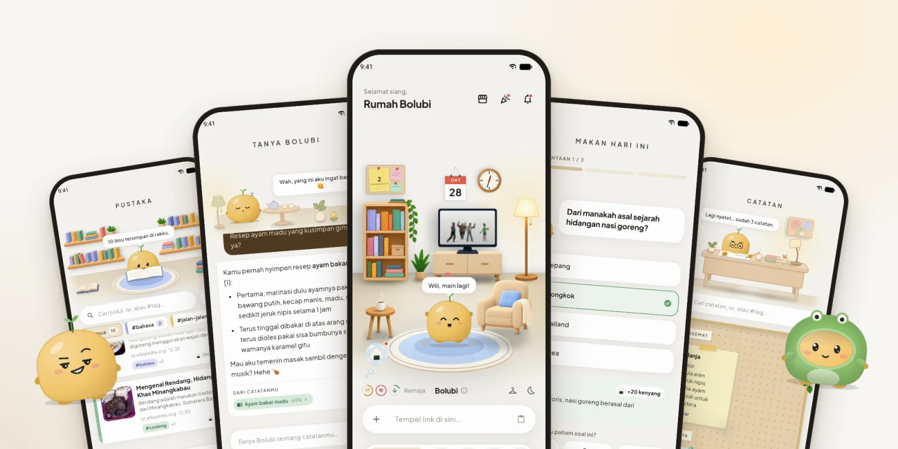
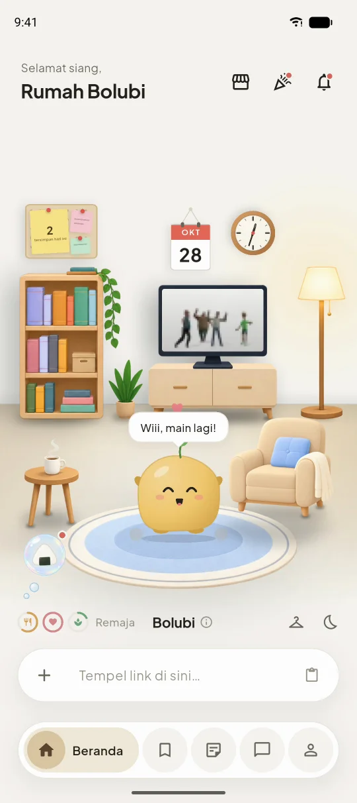
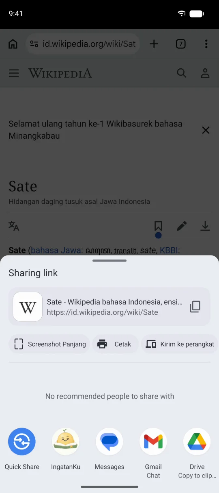
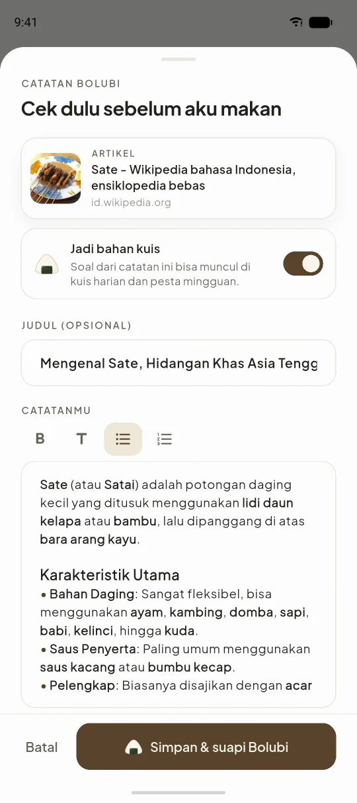
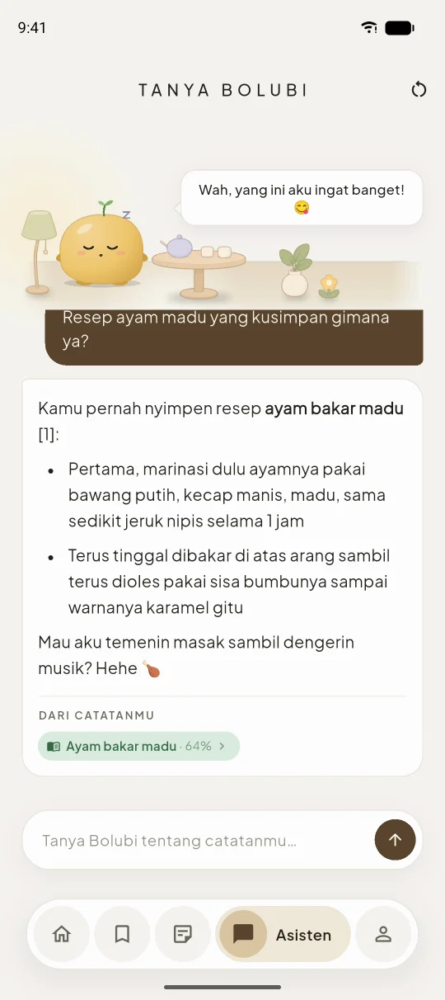
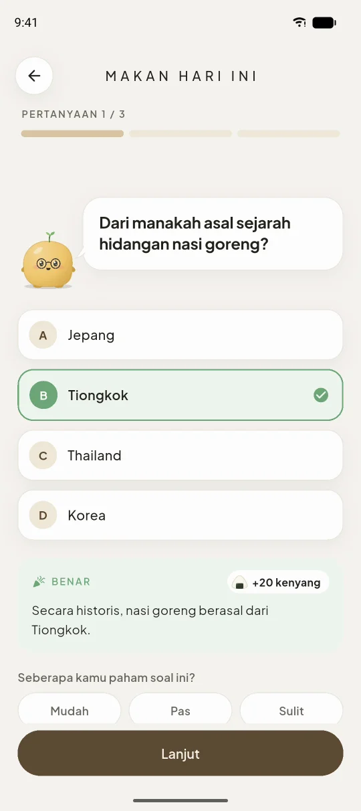
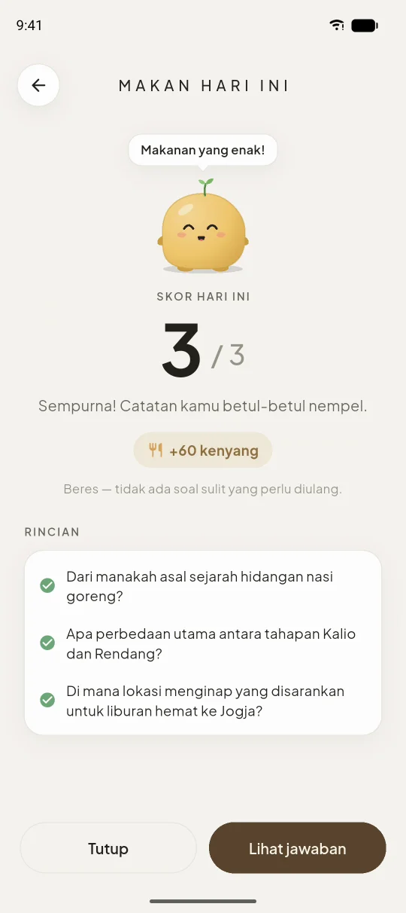
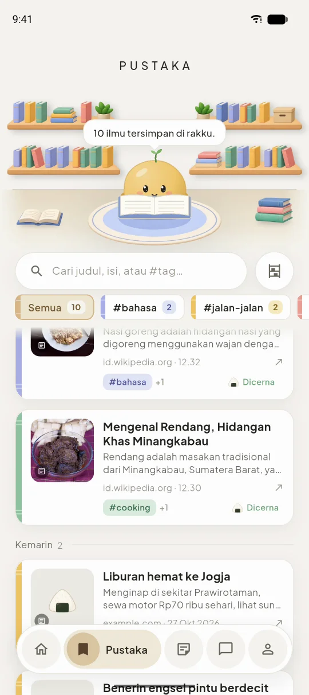
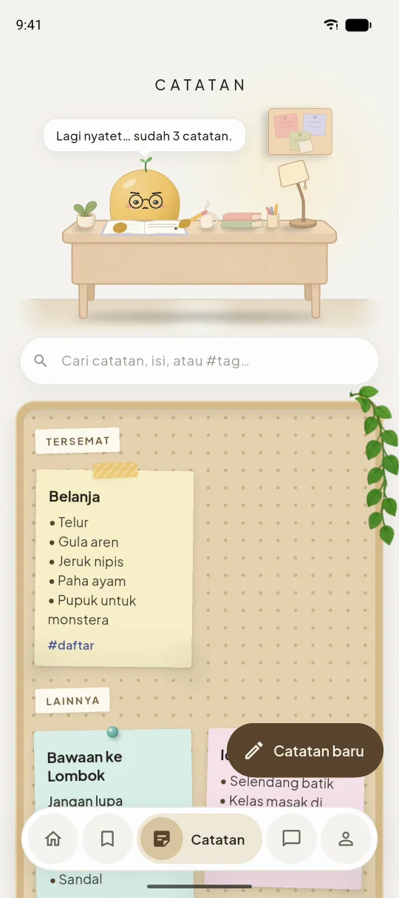

<div align="center">


# IngatanKu

**Semua yang kamu simpan, diingat.**

Simpan resep, tips jalan-jalan, dan video dari app mana saja. Bolubi, peliharaan kecil yang tinggal di dalam app, menuliskan catatannya untukmu, menjawab pertanyaanmu tentang catatan itu, dan memberi kuis kecil setiap hari supaya kamu tidak lupa.

[English](README.md) &nbsp;|&nbsp; **Bahasa Indonesia**

<p>
  
  
  
  
</p>
<p>
  
  
  
</p>

[**Ikut beta**](https://ingatanku.temanlabs.tech/id/) &nbsp;•&nbsp; [**Fitur**](#fitur) &nbsp;•&nbsp; [**Tampilan**](#tampilan) &nbsp;•&nbsp; [**Cara kerja**](#cara-kerja) &nbsp;•&nbsp; [**Build sendiri**](#build-sendiri) &nbsp;•&nbsp; [**Changelog**](CHANGELOG.id.md)

<br />



</div>

<br />

## Sorotan

<table>
  <tr>
    <td align="center" width="33%">
      <br />
      
      <p><b>Simpan dari app mana saja</b><br /><sub>Ketuk Bagikan di TikTok, YouTube, Instagram, atau browser, lalu pilih IngatanKu. Tanpa salin link.</sub></p>
      <br />
    </td>
    <td align="center" width="33%">
      <br />
      
      <p><b>Ditulis untukmu</b><br /><sub>Bolubi membaca link-nya, lalu menuliskan judul, ringkasan singkat, dan tag-nya.</sub></p>
      <br />
    </td>
    <td align="center" width="33%">
      <br />
      
      <p><b>Tanya saja</b><br /><sub>Lupa lihat di mana? Bolubi menjawab dari catatanmu sendiri, lengkap dengan sumbernya.</sub></p>
      <br />
    </td>
  </tr>
  <tr>
    <td align="center" width="33%">
      <br />
      
      <p><b>Tiga soal sehari</b><br /><sub>Kuis harian dari yang kamu simpan. Jawabanmu jadi makanan Bolubi.</sub></p>
      <br />
    </td>
    <td align="center" width="33%">
      <br />
      
      <p><b>Tumbuh bersamamu</b><br /><sub>Dari telur mungil sampai jadi bijak, didandani sesukamu.</sub></p>
      <br />
    </td>
    <td align="center" width="33%">
      <br />
      
      <p><b>Milikmu, offline pun bisa</b><br /><sub>Catatanmu hanya bisa dilihat olehmu, dan tetap bisa dibuka tanpa internet.</sub></p>
      <br />
    </td>
  </tr>
</table>

## Dapatkan IngatanKu

IngatanKu sedang dalam **beta tertutup di Android** (7.0 atau lebih baru). Tinggalkan email akun Google yang kamu pakai di Play Store di **[ingatanku.temanlabs.tech](https://ingatanku.temanlabs.tech/id/)**, nanti undangannya dikirim. Setiap versi yang diberi tag juga diterbitkan sebagai `.apk` di halaman **[Releases](../../releases)**.

Gratis selama beta. Perubahan di setiap versi ada di **[changelog](CHANGELOG.id.md)**.

## Fitur

### Menyimpan
| Fitur | Fungsi |
|---|---|
| **Bagikan ke IngatanKu** | Bagikan link dari app mana saja (TikTok, YouTube, Instagram, X, browser), dan link-nya masuk ke kolom link di rumah Bolubi. Bisa juga ditempel sendiri di sana. |
| **Catatan otomatis** | Bolubi membaca halamannya, detail videonya, atau caption postingannya, lalu menulis catatannya: judul singkat, ringkasan yang bentuknya menyesuaikan isinya (resep jadi bahan dan langkah, perjalanan jadi tempat dan biaya), dan 2 sampai 4 tag. Kamu cek dulu sebelum disimpan, dan pilih apakah kuis boleh menanyakannya. |
| **Pustaka** | Semua yang kamu simpan, yang terbaru di atas, dikelompokkan per tag. Cari berdasarkan judul, isi, atau `#tag`. |
| **Catatan** | Catatanmu sendiri di samping yang kamu simpan, dengan foto, judul, dan daftar, ditempel di papan. |

### Mengingat
| Fitur | Fungsi |
|---|---|
| **Tanya Bolubi** | Tanya dengan kalimatmu sendiri, dalam bahasa Indonesia atau Inggris. Bolubi mencari catatan yang sesuai maksudmu (bukan sekadar katanya), menjawab dari situ, menunjukkan catatan yang dipakai, dan ingat percakapannya untuk pertanyaan lanjutan. |
| **Kuis harian** | Tiga soal sehari dari catatanmu. Jawaban benar terasa enak; jawaban salah tetap dimakan, dengan wajah lucu. Setelah menjawab, kamu bisa bilang seberapa paham, dan soal yang sulit akan muncul lagi lebih cepat. |
| **Pesta mingguan** | Kuis lebih panjang dari catatan seminggu terakhir. Bikin Bolubi cepat besar. |

### Bolubi
| Fitur | Fungsi |
|---|---|
| **Menetas dan tumbuh** | Bolubi menetas dari telur, lalu tumbuh dari Bayi, Anak, Remaja, dan Dewasa sampai Bijak. Setiap catatan adalah camilan dan setiap kuis adalah makanan. Kamu yang memberinya nama. |
| **Kamarnya** | Elus, angkat, biarkan tidur, lihat dia membaca atau menyalakan TV. Sesekali temannya datang berkunjung. |
| **Lemari baju** | Tujuh warna, topi dan kacamata yang terbuka seiring dia tumbuh, dan baju di butik. |
| **Widget layar utama** | Lapar selama kuis hari ini menunggu, agak sedih menjelang malam, senang setelah diberi makan. Tombolnya membuka kuis. |
| **Pengingat lembut** | Pengingat harian, supaya Bolubi tidak pernah kelaparan. |

### Sehari-hari
- **Bisa offline**: catatan langsung tersimpan di HP dan disinkronkan saat kembali online.
- **Bahasa Indonesia dan Inggris**, bisa diganti kapan saja di dalam app.
- **Masuk dengan Google** atau dengan email dan password.
- Petunjuk singkat saat pertama kali membuka setiap bagian app.

## Tampilan

<table>
  <tr>
    <td width="25%"><p align="center"><b>Rumah Bolubi</b></p></td>
    <td width="25%"><p align="center"><b>Bagikan</b> dari app mana saja</p></td>
    <td width="25%"><p align="center"><b>Catatan otomatis</b>, dicek sebelum disimpan</p></td>
    <td width="25%"><p align="center"><b>Tanya Bolubi</b>, dengan sumbernya</p></td>
  </tr>
  <tr>
    <td width="25%"><p align="center"><b>Kuis harian</b></p></td>
    <td width="25%"><p align="center"><b>Skor hari ini</b></p></td>
    <td width="25%"><p align="center"><b>Pustaka</b> dan koleksinya</p></td>
    <td width="25%"><p align="center"><b>Catatan</b> di papan</p></td>
  </tr>
</table>

## Cara kerja

```
IngatanKu (Flutter, Android)
  ├─ SQLite di HP ── semua catatan, supaya app bisa dipakai offline; disinkronkan di latar belakang
  ├─ Supabase Auth ── email dan password, Google
  └─ Supabase
       ├─ Postgres + pgvector ── catatan, kuis, dan pet; Row Level Security di setiap tabel
       └─ Edge Functions (Deno)
            ├─ auto-summarize ── membaca link (halaman, YouTube, Microlink) ──▶ Workers AI (Gemma 4)
            ├─ ask-brain ── mencari catatan yang cocok (embedding BGE-M3) ──▶ Workers AI
            ├─ embed-note · reembed-missing ── embedding untuk pencarian ──▶ Workers AI (BGE-M3)
            ├─ daily-quiz · generate-weekly-quiz · record-quiz-answer ── kuis
            ├─ fetch-meta · resolve-media ── pratinjau link dan media
            └─ beta-signup ── form beta di website
landing/ (Astro + React) ── website, dijalankan nginx di Docker
```

Setiap permintaan ke AI dihitung dari jatah harian kecil per akun, supaya satu akun tidak menghabiskan jatah gratis untuk semua orang.

<details>
<summary><b>Struktur proyek</b></summary>

```
├─ lib/
│  ├─ core/               Tema, routing, database lokal dan sinkronisasi, layanan (suara, notifikasi, widget, berbagi)
│  ├─ features/           Satu folder per bagian app, masing-masing dibagi data / domain / presentation
│  │  ├─ dashboard/       Rumah Bolubi: kamar, kolom link, dan catatan otomatis
│  │  ├─ companion/       Bolubi sendiri: gambar, suasana hati, pertumbuhan, lemari baju
│  │  ├─ vault/           Pustaka
│  │  ├─ notes/           Catatan pribadi
│  │  ├─ ai_chat/         Tanya Bolubi
│  │  ├─ quiz/            Kuis harian dan pesta mingguan
│  │  └─ auth/ onboarding/ profile/
│  ├─ shared/             Widget yang dipakai di banyak tempat (coachmark, editor markdown…)
│  └─ l10n/               Teks bahasa Inggris dan Indonesia
├─ android/               App Android, termasuk widget layar utama (Kotlin)
├─ assets/                Gambar kamar, suara, klip TV, SVG brand
├─ supabase/
│  ├─ migrations/         Database: satu baseline, lalu satu file per perubahan
│  ├─ functions/          Edge Functions, kode bersamanya di _shared/
│  └─ templates/          Email login
├─ landing/               Website (Astro + React), dengan Dockerfile-nya
├─ test/                  Unit test dan widget test
├─ tools/                 Render ikon, sound kit, penguji model AI
└─ .github/readme/        Banner dan screenshot README
```

</details>

## Build sendiri

Yang dibutuhkan: **Flutter 3.35** atau lebih baru, HP Android atau emulator, [Supabase CLI](https://supabase.com/docs/guides/cli), project **Supabase**, dan akun **Cloudflare** untuk Workers AI (jatah gratisnya cukup untuk beta kecil).

**Backend**, dari root repo:

```bash
supabase link --project-ref <project-ref>
supabase db push                       # skema, dari supabase/migrations/
supabase secrets set \
  OPENAI_BASE_URL=https://api.cloudflare.com/client/v4/accounts/<account-id>/ai/v1 \
  OPENAI_API_KEY=<API token Cloudflare> \
  OPENAI_CHAT_MODEL=@cf/google/gemma-4-26b-a4b-it \
  AI_CHAT_EXTRA='{"chat_template_kwargs":{"enable_thinking":false}}' \
  OPENAI_EMBED_MODEL=@cf/baai/bge-m3 \
  AI_HEDGE_AFTER_MS=0
supabase functions deploy              # semua function di supabase/functions/
```

Lalu, di dashboard Supabase:
- tambahkan `ingatanku` di **Project Settings → Data API → Exposed schemas**;
- untuk email pendaftaran, aktifkan SMTP sendiri dan salin template dari `supabase/templates/` (app memakai kode 6 digit);
- untuk login Google, aktifkan provider Google dengan web client ID dari Google Cloud, dan daftarkan package serta SHA-1 app di sana sebagai client Android.

Secret opsional: `AI_LIMIT_ASK`, `AI_LIMIT_SUMMARIZE`, `AI_LIMIT_QUIZ`, dan `AI_LIMIT_EMBED` (jatah AI harian tiap akun), serta `COBALT_API_BASE` untuk menyimpan video offline.

**App-nya:**

```bash
flutter pub get
cp supabase.example.json supabase.cloud.json   # URL dan key project-mu, serta Google web client ID
flutter run --dart-define-from-file=supabase.cloud.json
```

- **Tes**: `flutter test`, dan `flutter analyze` harus tetap bersih.
- **Ikon app**: ubah SVG di `assets/brand/`, lalu jalankan `tools/make_icons.sh`.
- **Website**: lihat [landing/README.id.md](landing/README.id.md).

### Versi dan changelog

- Versi hanya ditulis di satu tempat: `version` di `pubspec.yaml` (`1.0.0-beta+1`: nama versi, lalu nomor build). App membacanya dari sana.
- Setiap perubahan yang terasa oleh pengguna dapat satu baris di bawah `## [Unreleased]` di changelog, dalam dua bahasa: [CHANGELOG.md](CHANGELOG.md) dan [CHANGELOG.id.md](CHANGELOG.id.md).
- Saat rilis: naikkan versinya (nomor build selalu naik satu), ubah `[Unreleased]` menjadi `[versi] - tanggal`, lalu beri tag `v<versi>`, misalnya `v1.0.0-beta.2`.
- `test/release_test.dart` gagal kalau versi di `pubspec.yaml` belum punya bagian bertanggal di salah satu changelog.

## Privasi

- **Catatanmu milikmu.** Catatan disimpan di Postgres di Supabase (region Asia Tenggara) dengan Row Level Security, jadi setiap akun hanya bisa melihat datanya sendiri. Semua koneksi memakai HTTPS.
- Salinan catatanmu juga ada **di HP-mu**, supaya bisa dibuka offline.
- **Yang dilihat AI:** server membaca link yang kamu bagikan (langsung atau lewat Microlink) dan mengirim teksnya ke Cloudflare Workers AI untuk ditulis jadi catatan. Teks catatanmu juga dikirim ke sana untuk diindeks supaya bisa dicari, untuk membuat soal kuis, dan bersama pertanyaanmu saat kamu bertanya ke Bolubi.
- **Tanpa iklan, tanpa analitik pihak ketiga, tanpa menjual data.**
- Catatan bisa diubah atau dihapus kapan saja. Menghapus seluruh akun dari dalam app akan segera tersedia; sementara ini, minta lewat kontak di halaman Tentang.

## Dokumentasi

| Dokumen | Isi |
|---|---|
| Changelog · [English](CHANGELOG.md) · [Bahasa Indonesia](CHANGELOG.id.md) | Perubahan di setiap versi |
| Website · [English](landing/README.md) · [Bahasa Indonesia](landing/README.id.md) | Website: menjalankan, build, dan deploy dengan Docker |

## Kredit

Dibangun dengan [Flutter](https://flutter.dev/), [Supabase](https://supabase.com/), [pgvector](https://github.com/pgvector/pgvector), [Cloudflare Workers AI](https://developers.cloudflare.com/workers-ai/) ([Gemma](https://ai.google.dev/gemma) dari Google dan [BGE-M3](https://huggingface.co/BAAI/bge-m3) dari BAAI), [Microlink](https://microlink.io/), [flutter_bloc](https://bloclibrary.dev/), [go_router](https://pub.dev/packages/go_router), [home_widget](https://pub.dev/packages/home_widget), [receive_sharing_intent](https://pub.dev/packages/receive_sharing_intent), [audioplayers](https://pub.dev/packages/audioplayers), dan [sqflite](https://pub.dev/packages/sqflite). Website-nya dibangun dengan [Astro](https://astro.build/) dan [React](https://react.dev/). Huruf yang dipakai adalah [Plus Jakarta Sans](https://fonts.google.com/specimen/Plus+Jakarta+Sans), dan logonya digambar dari [Fredoka](https://fonts.google.com/specimen/Fredoka).

## Lisensi

IngatanKu dirilis dengan [Lisensi MIT](LICENSE). Library dan layanan yang dipakainya tetap memakai lisensinya masing-masing.

<div align="center">
<br />
<sub>Dibuat di Indonesia oleh <a href="https://github.com/diopratama99">Dio Pratama</a> · TemanLabs</sub>
</div>
