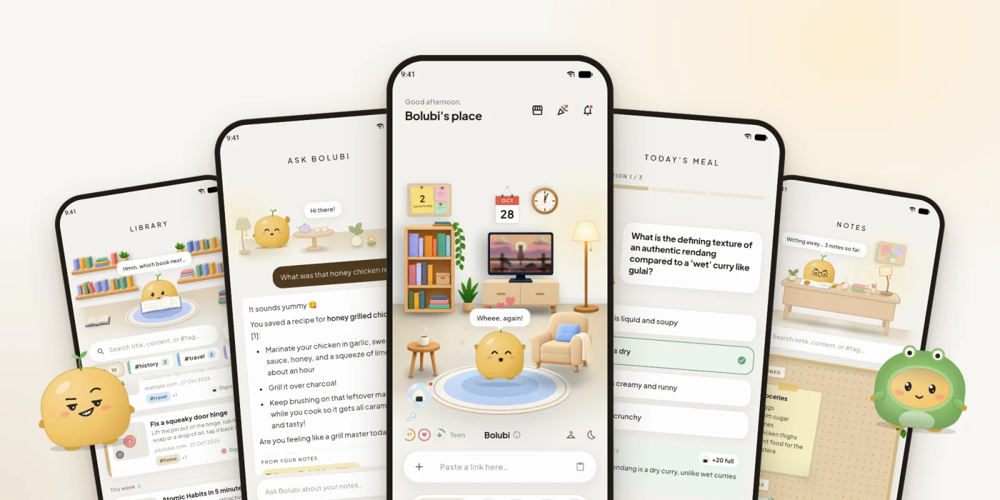
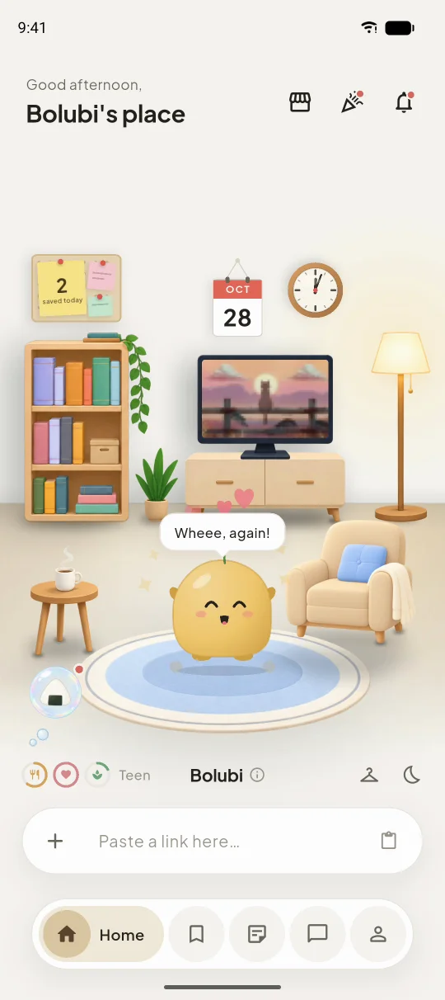
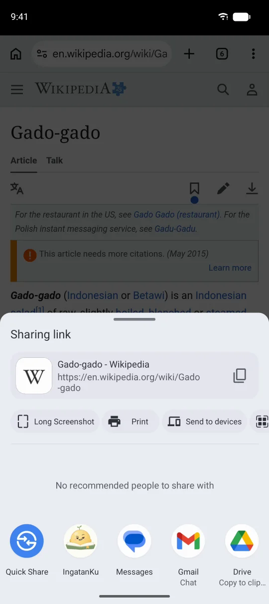
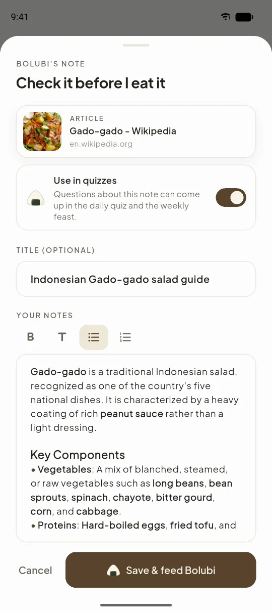
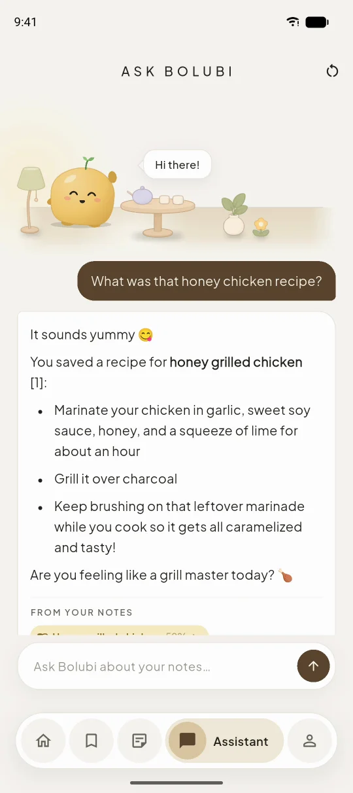
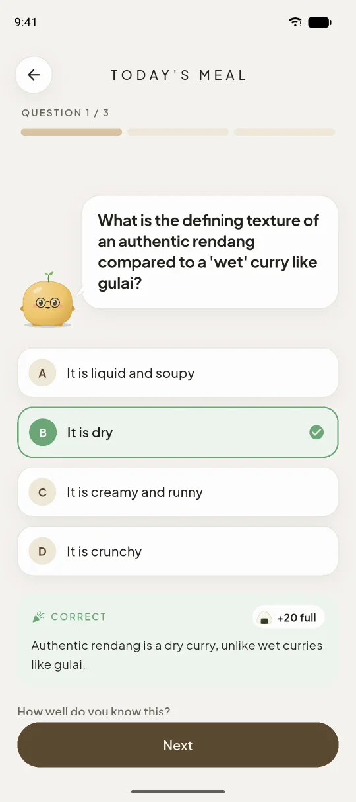
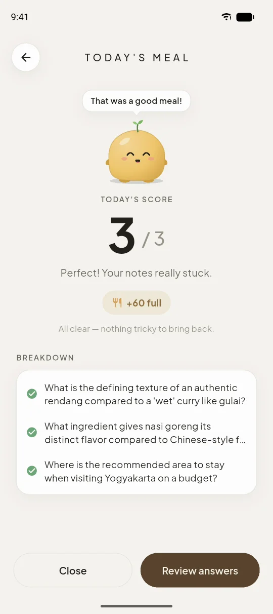
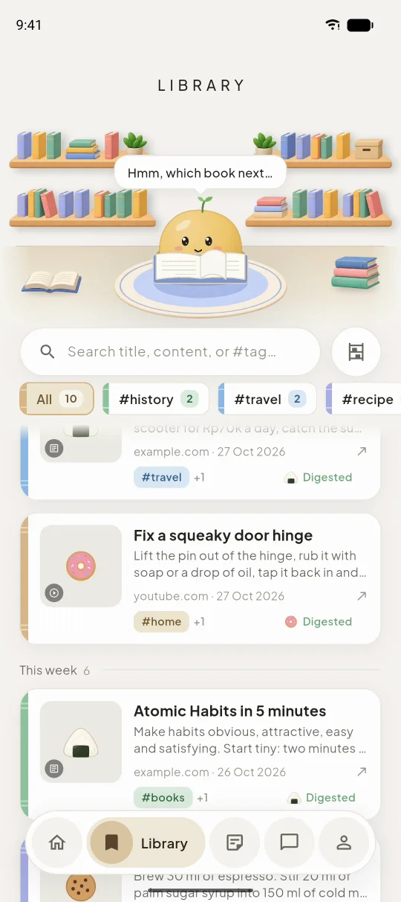
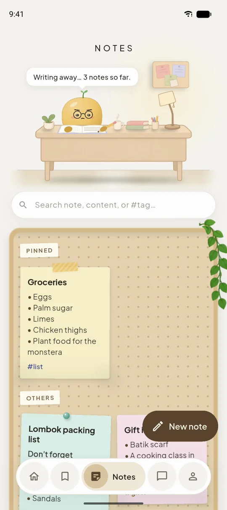

<div align="center">


# IngatanKu

**Everything you save, remembered.**

Save recipes, travel tips and videos from any app. Bolubi, a little pet that lives in the app, writes the notes for you, answers your questions about them, and quizzes you a little every day so they stick.

**English** &nbsp;|&nbsp; [Bahasa Indonesia](README.id.md)

<p>
  
  
  
  
</p>
<p>
  
  
  
</p>

[**Join the beta**](https://ingatanku.temanlabs.tech) &nbsp;•&nbsp; [**Features**](#features) &nbsp;•&nbsp; [**Screenshots**](#screenshots) &nbsp;•&nbsp; [**How it works**](#how-it-works) &nbsp;•&nbsp; [**Build it**](#build-it-yourself) &nbsp;•&nbsp; [**Changelog**](CHANGELOG.md)

<br />



</div>

<br />

## Highlights

<table>
  <tr>
    <td align="center" width="33%">
      <br />
      
      <p><b>Save from any app</b><br /><sub>Tap Share in TikTok, YouTube, Instagram or a browser and pick IngatanKu. No copying links.</sub></p>
      <br />
    </td>
    <td align="center" width="33%">
      <br />
      
      <p><b>Written for you</b><br /><sub>Bolubi reads the link and writes the title, a short summary and the tags.</sub></p>
      <br />
    </td>
    <td align="center" width="33%">
      <br />
      
      <p><b>Just ask</b><br /><sub>Forgot where you saw it? Bolubi answers from your own notes and shows which ones.</sub></p>
      <br />
    </td>
  </tr>
  <tr>
    <td align="center" width="33%">
      <br />
      
      <p><b>Three questions a day</b><br /><sub>A daily quiz from what you saved. Your answers are Bolubi's meals.</sub></p>
      <br />
    </td>
    <td align="center" width="33%">
      <br />
      
      <p><b>Grows with you</b><br /><sub>From a tiny egg to a wise old sage, dressed the way you like.</sub></p>
      <br />
    </td>
    <td align="center" width="33%">
      <br />
      
      <p><b>Yours, even offline</b><br /><sub>Only you can see your notes, and they open without a connection.</sub></p>
      <br />
    </td>
  </tr>
</table>

## Get IngatanKu

IngatanKu is in **closed beta on Android** (7.0 or newer). Leave the email of the Google account you use on the Play Store at **[ingatanku.temanlabs.tech](https://ingatanku.temanlabs.tech)** and you'll get an invite. Each tagged version is also published as an `.apk` on the **[Releases](../../releases)** page.

It's free during the beta. What changed in each version is in the **[changelog](CHANGELOG.md)**.

## Features

### Saving
| Feature | What it does |
|---|---|
| **Share to IngatanKu** | Share a link from any app (TikTok, YouTube, Instagram, X, a browser) and it lands in the link bar on Bolubi's home, or paste one there yourself. |
| **The write-up** | Bolubi reads the page, the video's details or the post's caption, then writes the note: a short title, a summary shaped to what it is (a recipe gets its ingredients and steps, a trip its places and costs) and 2 to 4 tags. You check it before it's saved, and choose whether the quiz may ask about it. |
| **Library** | Everything you saved, newest first, grouped into collections by tag. Search by title, content or `#tag`. |
| **Notes** | Your own notes next to what you save, with photos, headings and lists, pinned to a board. |

### Remembering
| Feature | What it does |
|---|---|
| **Ask Bolubi** | Ask in your own words, in English or Indonesian. Bolubi finds the notes that match what you mean (not just the words), answers from them, shows which ones it used, and remembers the conversation for follow-up questions. |
| **Daily quiz** | Three questions a day from your notes. A right answer tastes great; a wrong one still gets eaten, with a funny face. After each answer you can say how well you knew it, and the hard ones come back sooner. |
| **Weekly feast** | A longer quiz on the past week's notes. It makes Bolubi grow fast. |

### Bolubi
| Feature | What it does |
|---|---|
| **Hatching and growing** | Bolubi hatches from an egg and grows up from Baby through Kid, Teen and Adult to Sage. Every note is a snack and every quiz a meal. You give it its name. |
| **Its room** | Pet it, pick it up, let it nap, watch it read or switch on the TV. Friends drop by now and then. |
| **Wardrobe** | Seven colours, hats and glasses it grows into, and outfits in the boutique. |
| **Home screen widget** | Hungry while today's quiz waits, a little sad by evening, happy once it's fed. Its button opens the quiz. |
| **A gentle nudge** | A daily reminder, so Bolubi never goes hungry. |

### Everyday
- **Works offline**: notes save at once on the phone and sync when you're back online.
- **English and Indonesian**, switchable any time in the app.
- **Sign in with Google** or with an email and password.
- Short guided tips the first time you meet each part of the app.

## Screenshots

<table>
  <tr>
    <td width="25%"><p align="center"><b>Bolubi's room</b></p></td>
    <td width="25%"><p align="center"><b>Share</b> from any app</p></td>
    <td width="25%"><p align="center"><b>The write-up</b>, checked before saving</p></td>
    <td width="25%"><p align="center"><b>Ask Bolubi</b>, with its sources</p></td>
  </tr>
  <tr>
    <td width="25%"><p align="center"><b>Daily quiz</b></p></td>
    <td width="25%"><p align="center"><b>Today's score</b></p></td>
    <td width="25%"><p align="center"><b>Library</b> and collections</p></td>
    <td width="25%"><p align="center"><b>Notes</b> on a board</p></td>
  </tr>
</table>

## How it works

```
IngatanKu (Flutter, Android)
  ├─ SQLite on the phone ── every note, so the app works offline; synced in the background
  ├─ Supabase Auth ── email and password, Google
  └─ Supabase
       ├─ Postgres + pgvector ── notes, quizzes, the pet; Row Level Security on every table
       └─ Edge Functions (Deno)
            ├─ auto-summarize ── reads the link (page, YouTube, Microlink) ──▶ Workers AI (Gemma 4)
            ├─ ask-brain ── finds the notes that match (BGE-M3 embeddings) ──▶ Workers AI
            ├─ embed-note · reembed-missing ── embeddings for search ──▶ Workers AI (BGE-M3)
            ├─ daily-quiz · generate-weekly-quiz · record-quiz-answer ── the quizzes
            ├─ fetch-meta · resolve-media ── link previews and media
            └─ beta-signup ── the website's beta form
landing/ (Astro + React) ── the website, served by nginx in Docker
```

Every request to the AI counts against a small daily allowance per account, so one account can't use up the free tier for everyone.

<details>
<summary><b>Project layout</b></summary>

```
├─ lib/
│  ├─ core/               Theme, routing, local database and sync, services (sounds, notifications, widget, sharing)
│  ├─ features/           One folder per part of the app, each split into data / domain / presentation
│  │  ├─ dashboard/       Bolubi's home: the room, the link bar and the write-up
│  │  ├─ companion/       Bolubi itself: drawing, moods, growth, wardrobe
│  │  ├─ vault/           The library
│  │  ├─ notes/           Your own notes
│  │  ├─ ai_chat/         Ask Bolubi
│  │  ├─ quiz/            Daily quiz and weekly feast
│  │  └─ auth/ onboarding/ profile/
│  ├─ shared/             Widgets used across the app (coachmarks, the markdown editor…)
│  └─ l10n/               English and Indonesian text
├─ android/               The Android app, including the home screen widget (Kotlin)
├─ assets/                Room art, sounds, the TV clips, brand SVGs
├─ supabase/
│  ├─ migrations/         The database: one baseline, then a file per change
│  ├─ functions/          Edge Functions, with shared code in _shared/
│  └─ templates/          Sign-in emails
├─ landing/               The website (Astro + React), with its Dockerfile
├─ test/                  Unit and widget tests
├─ tools/                 Icon rendering, the sound kit, an AI model tester
└─ .github/readme/        The README's banner and screenshots
```

</details>

## Build it yourself

You need **Flutter 3.35** or newer, an Android device or emulator, the [Supabase CLI](https://supabase.com/docs/guides/cli), a **Supabase** project and a **Cloudflare** account for Workers AI (its free tier covers a small beta).

**The backend**, from the repo's root:

```bash
supabase link --project-ref <project-ref>
supabase db push                       # the schema, from supabase/migrations/
supabase secrets set \
  OPENAI_BASE_URL=https://api.cloudflare.com/client/v4/accounts/<account-id>/ai/v1 \
  OPENAI_API_KEY=<Cloudflare API token> \
  OPENAI_CHAT_MODEL=@cf/google/gemma-4-26b-a4b-it \
  AI_CHAT_EXTRA='{"chat_template_kwargs":{"enable_thinking":false}}' \
  OPENAI_EMBED_MODEL=@cf/baai/bge-m3 \
  AI_HEDGE_AFTER_MS=0
supabase functions deploy              # every function in supabase/functions/
```

Then, in the Supabase dashboard:
- add `ingatanku` to **Project Settings → Data API → Exposed schemas**;
- for sign-up emails, turn on custom SMTP and copy the templates from `supabase/templates/` (the app expects 6-digit codes);
- for Google sign-in, turn on the Google provider with a web client ID from Google Cloud, and register the app's package and SHA-1 there as an Android client.

Optional secrets: `AI_LIMIT_ASK`, `AI_LIMIT_SUMMARIZE`, `AI_LIMIT_QUIZ` and `AI_LIMIT_EMBED` (each account's daily AI allowance), and `COBALT_API_BASE` for saving videos offline.

**The app:**

```bash
flutter pub get
cp supabase.example.json supabase.cloud.json   # your project's URL and key, and the Google web client ID
flutter run --dart-define-from-file=supabase.cloud.json
```

- **Tests**: `flutter test`, and `flutter analyze` should stay clean.
- **App icon**: edit the SVGs in `assets/brand/`, then run `tools/make_icons.sh`.
- **Website**: see [landing/README.md](landing/README.md).

### Versions and the changelog

- The version lives in one place: `version` in `pubspec.yaml` (`1.0.0-beta+1`: the name, then the build number). The app reads it from there.
- Every change people will notice gets a line under `## [Unreleased]` in the changelog, in both languages: [CHANGELOG.md](CHANGELOG.md) and [CHANGELOG.id.md](CHANGELOG.id.md).
- A release bumps the version (the build number always goes up by one), turns `[Unreleased]` into `[version] - date`, and is tagged `v<version>`, for example `v1.0.0-beta.2`.
- `test/release_test.dart` fails when the version in `pubspec.yaml` has no dated section in either changelog.

## Privacy

- **Your notes are yours.** They live in Postgres on Supabase (Southeast Asia region) behind Row Level Security, so each account only ever sees its own rows. Every connection uses HTTPS.
- A copy of your notes stays **on your phone**, so they open offline.
- **What the AI sees:** the server reads a link you share (directly or through Microlink) and sends its text to Cloudflare Workers AI to write the note. The text of your notes also goes there to index them for search, to make quiz questions, and with your question when you ask Bolubi.
- **No ads, no third-party analytics, no data selling.**
- Notes can be edited or deleted any time. Deleting the whole account from inside the app is coming; until then, ask through the contact on the About page.

## Documentation

| Document | Contents |
|---|---|
| Changelog · [English](CHANGELOG.md) · [Bahasa Indonesia](CHANGELOG.id.md) | What changed in each version |
| Website · [English](landing/README.md) · [Bahasa Indonesia](landing/README.id.md) | The website: running it, building it, deploying it with Docker |

## Credits

Built with [Flutter](https://flutter.dev/), [Supabase](https://supabase.com/), [pgvector](https://github.com/pgvector/pgvector), [Cloudflare Workers AI](https://developers.cloudflare.com/workers-ai/) (Google's [Gemma](https://ai.google.dev/gemma) and BAAI's [BGE-M3](https://huggingface.co/BAAI/bge-m3)), [Microlink](https://microlink.io/), [flutter_bloc](https://bloclibrary.dev/), [go_router](https://pub.dev/packages/go_router), [home_widget](https://pub.dev/packages/home_widget), [receive_sharing_intent](https://pub.dev/packages/receive_sharing_intent), [audioplayers](https://pub.dev/packages/audioplayers) and [sqflite](https://pub.dev/packages/sqflite). The website is built with [Astro](https://astro.build/) and [React](https://react.dev/). Type is [Plus Jakarta Sans](https://fonts.google.com/specimen/Plus+Jakarta+Sans), and the logo is drawn from [Fredoka](https://fonts.google.com/specimen/Fredoka).

## License

IngatanKu is released under the [MIT License](LICENSE). The libraries and services it uses keep their own licenses.

<div align="center">
<br />
<sub>Made in Indonesia by <a href="https://github.com/diopratama99">Dio Pratama</a> · TemanLabs</sub>
</div>
